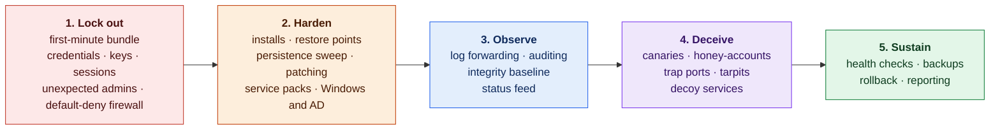
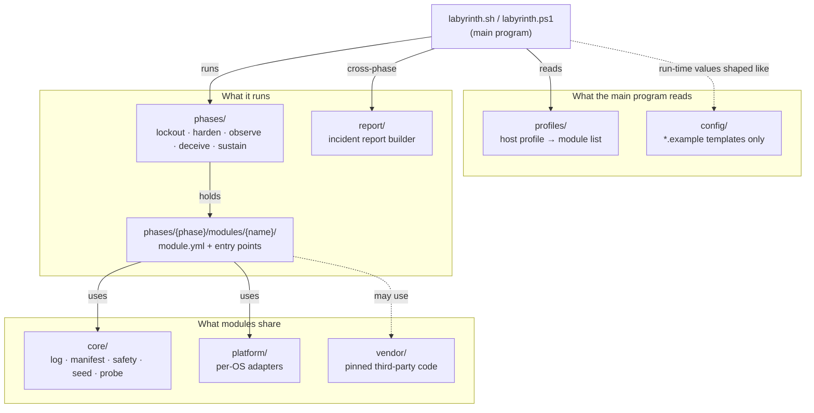
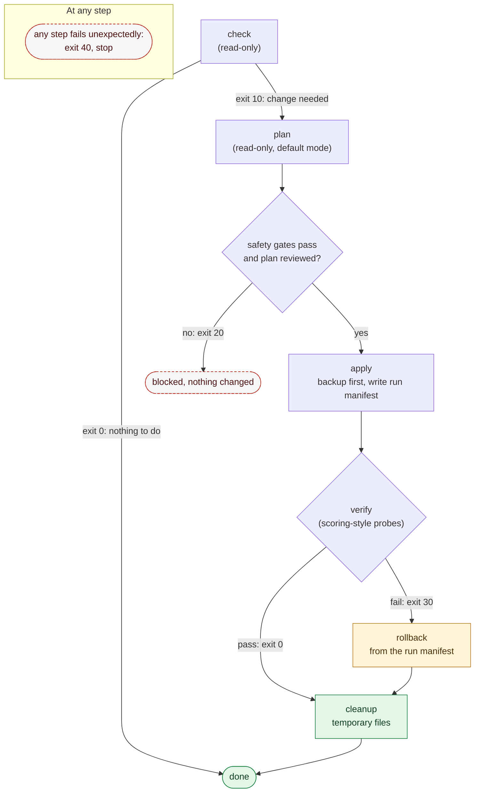

# 00. Module Contract and Repository Layout

## 1. Goal

One main Labyrinth program enables each phase. Each phase is an entry script that calls small, single-purpose modules. Adding a capability means adding a folder, not editing the core, which is how the design stays scalable.

## 2. Naming: phases, not "hardening"

"Hardening" is the umbrella word in the documents, but it covers more than one moment: a credential reset at minute zero is a different job from patching at hour two. Folders are therefore named after the doctrine phases, which are also the order the phases run in:

| Folder | Phase | Contains |
|---|---|---|
| `lockout` | 🟥 Lock out | The first-minute bundle: credentials, unregistered keys, remote-admin hardening, ending intruder sessions, locking unexpected admin accounts, default-deny firewall. Nothing is installed (design 03) |
| `harden` | 🟧 Harden | Behind the lockdown: installs, restore points, persistence sweep, vulnerability mitigations, patching and service reduction, service packs, Windows and AD hardening, service replacement and containers, official-package verification, then reopening outbound |
| `observe` | 🟦 Observe | Log forwarding, auditing, integrity baseline, status feed |
| `deceive` | 🟪 Deceive | Canaries, honey-accounts, trap ports, tarpits, decoy services |
| `sustain` | 🟩 Sustain | Health checks, backups, rollback, reporting |



*Figure: the five phases run in order, left to right, and each box lists the kinds of module its folder contains. Colors follow the phase key: red is lock out, orange is harden, blue is observe, purple is deceive and green is sustain.*

Harden is specified here ahead of the code. Until the runner builds the phase, the existing modules keep their current folders and `phase` values, and the phase folder `harden` does not exist yet (`docs/Roadmap.md`).

## 3. Repository layout

```
Labyrinth/
├── labyrinth.sh                 # main program for Linux hosts and control nodes (bash)
├── labyrinth.ps1                # main program for Windows hosts and control nodes (PowerShell)
├── install.sh                   # guided installer for Linux (Conventions, section 3.3)
├── install.ps1                  # guided installer for Windows
├── laby.cmd, labyrinth.cmd      # the Windows commands: launchers that run labyrinth.ps1
├── core/                        # shared library used by every module
│   ├── lib.sh                   # loads the bash core (entry points source it)
│   ├── Lab.ps1                  # loads the PowerShell core (entry points dot-source it)
│   ├── config/                  # run-time configuration readers (data only, never sourced)
│   ├── log/                     # structured logging (JSON lines)
│   ├── manifest/                # run manifest: what was changed, for rollback and cleanup
│   ├── safety/                  # protected set, gates, dead-man revert timers
│   ├── approval/                # approval items: item lines, fingerprints, approval checks
│   ├── quarantine/              # quarantine, never delete: move aside and restore (design 06)
│   ├── secret/                  # new passwords, shown once on the terminal (design 04)
│   ├── platform/                # platform facts: OS, firewall, role (design 01)
│   ├── seed/                    # event seed derivation (design 16)
│   └── probe/                   # scoring-style health probes
├── phases/
│   ├── lockout/
│   │   └── modules/
│   │       ├── credentials/     # one folder per module (contract below)
│   │       ├── accounts/
│   │       ├── firewall/
│   │       └── ssh/
│   ├── harden/   (same shape; planned, with the `service_reduction` module (`harden.service_reduction`), which stops services and so belongs here, not in lockout)
│   ├── observe/  (same shape)
│   ├── deceive/  (same shape)
│   └── sustain/  (same shape)
├── report/                      # incident report builder (design 20); cross-phase
├── profiles/                    # host profile → ordered module list
├── platform/                    # adapters (design 01): linux/firewall, ubuntu, rhel-family, windows, appliance runbooks
├── config/                      # templates only: *.example, never values
├── manual/                      # the built manual (man page, Get-Help topic): in a release, not in git
├── vendor/                      # pinned third-party code, each with LICENSE and NOTICE
├── tests/                       # lab tests and negative tests
└── docs/                        # design specs and the implementation blueprint
```

Notes:

- **Profiles** map hosts to modules, for example `linux-web`, `linux-siem`, `windows-dc`, `windows-member`, `appliance`. A profile is a list, not code.
- **Appliances** (for example VyOS or a Palo Alto firewall) are handled by templated configuration and a manual runbook, not remote-execution modules.
- **Language:** bash on Linux, Windows PowerShell 5.1 on Windows. No interpreter or package has to be installed for Labyrinth itself to run (section 9); the tools it adds to a host come from design 02.



*Figure: the main program reads a profile and runs the phase's modules in profile order, which share the core library and per-OS adapters; dashed lines are optional or run-time-only links.*

## 4. The module contract

Every module is a folder containing a metadata file, a help page and up to six entry points.

`module.yml` fields:

| Field | Meaning |
|---|---|
| `id` | Unique name, for example `lockout.firewall` |
| `title` | The plain name an operator reads first, for example `Firewall`: plain ASCII, at most 40 characters |
| `phase` | `lockout`, `harden`, `observe`, `deceive` or `sustain` (`harden` is specified, not built yet) |
| `priority` | P0 to P3 (P0 runs first, P3 last) |
| `platforms` | `ubuntu`, `rhel-family`, `windows`, `appliance` |
| `risk` | `read-only`, `reversible`, `service-affecting`, `approval` or `manual-only` |
| `touches_scored` | `true` if it can affect a scored service or account |
| `requires` | Other modules or facts that must exist first |
| `outputs` | Files and state it creates, so cleanup can find them |
| `tools` | Optional, a list of command names the module cannot work without on Linux, such as `[ss]`. `laby --doctor` checks that each is on the `PATH` of a host whose profile lists the module. List only a hard need: a command the module works around when it is missing is left out. A missing field means no tools to check |
| `tools_windows` | Optional, the same for Windows, where a name is a cmdlet or a command, such as `[Get-NetTCPConnection]` |
| `keep_on_verify` | Optional, `true` or `false` (the default), for a module that changes something (`reversible`, `service-affecting` or `approval`). `true` means the change is kept as soon as it verifies and no scored service got worse, so the revert timer no longer undoes it (rule 9 below). It is only for a change that takes access away from someone other than the team and cannot lock the team out or cut off scoring |
| `pre_approvable` | Optional, for an `approval` module only: the item categories a pre-approval rule may approve (Conventions, section 3.1). A category belongs here only if an item of it is safe to change without a person seeing it: the module checks the item fully, and the change can be undone or breaks nothing. Examples are a security update for a named package (design 10, section 4), a known default application password (design 04, section 2.1) and a setting that is approval-class only because the installed version was not tested in the lab (design 11, section 4) |

`about.txt` is the module's help page, printed by `laby -h <module-id>` under a summary of `module.yml` in plain words. It is plain text, at most 78 columns, and fits one screen. It answers, in this order and in short sentences: what the module checks, what it changes, why, what can go wrong and what Labyrinth does about it, how to undo it, and what to do when it fails. Every module in a release has one; a module without it still runs, and its help page says the page is missing.

Entry points:

| Entry point | Purpose | Must be |
|---|---|---|
| `check` | Is a change needed? | Read-only. Exits `10` if a change is needed and `0` if not |
| `plan` | Show exactly what `apply` would do | Read-only. This is the default mode. Exits like `check`: `10` when it lists changes, `0` when it lists none |
| `apply` | Make the change | Idempotent; backs up first; writes to the run manifest |
| `verify` | Confirm the change worked and nothing scored broke | Read-only |
| `rollback` | Undo `apply` from the manifest | Safe to run repeatedly |
| `cleanup` | Remove temporary files this module created | Safe to run repeatedly |

A module of risk `reversible`, `service-affecting` or `approval` must have `check`, `apply`, `verify` and `rollback`. A module of risk `read-only` or `manual-only` never changes anything, so it must not have `apply`, `rollback` or `cleanup`. A `read-only` module may still record: in a run, after every module is planned and before the first change, the runner calls its `check` once more with `LAB_DRY_RUN=0` (Conventions, section 3.1, step 6), and only in that call may `check` write its own files under the state folder (`LAB_STATE_DIR`), as the inventory does (design 08, section 3.1). In a preview, and in the plan stage of a run, `LAB_DRY_RUN` is `1` and `check` and `plan` write nothing. Recording is the only exception to "never changes anything", and it adds nothing to the run manifest's list of changes. A module that only observed exits `0`. The runner refuses to load a module that breaks either rule (`40`), in plan mode too, so its risk can be trusted.

Exit codes:

| Code | Meaning |
|---|---|
| `0` | Nothing to do, or success |
| `10` | Change needed |
| `20` | Blocked by a safety gate |
| `30` | Verify failed |
| `40` | Error |



*Figure: one module run moves from check to plan to an apply behind the safety gates, with no one typing during the run, then verify decides between cleanup and rollback; each arrow shows its exit code, and exit 40 can end the run at any step. Green marks a clean finish, amber an undo, and a dashed red outline a stop.*

Rules for module authors:

1. `touches_scored: true` modules run only after the protected set and the services file are loaded. The scoring allowlist is optional: where present it is applied first, but the gate is that every scored service has an allow from any source (design 03, section 7).
2. An `approval` module lists each item it would change, with the reason, and changes only the items a person approves, per item or per category on one host, or that the team approved before the event with a pre-approval rule (Conventions, section 3.1). Approved items go through the same backup, manifest, verify and rollback as any other change.
3. A `manual-only` module never changes anything. It prints a checklist for a human. This is kept for actions too broad or too hard to undo for Labyrinth to carry out even with approval: Group Policy changes, DNS changes on a domain controller, domain controller restores, rescuing an unbootable host, Windows patching and appliance changes.
4. No module calls an outside service or sends data out of the competition environment (National Collegiate Cyber Defense Competition [NCCDC], 2025, Rule 5.6.4). Only the `packages` module and the core download helper install or download software, after the first-minute lockdown, from the public sources of design 02.
5. No module deliberately breaks expected functionality (NCCDC, 2025, Rule 5.6.5).
6. No module deletes a file. Anything removed is quarantined (design 06, section 5). An account is deleted only by the account module, after approval (design 04, section 6).
7. A module writes its output for a beginner, as `key: text` lines with a key from `found`, `will do`, `did`, `why`, `risk`, `problem`, `cause`, `fix` and `undo`: `found: password logins are on`, `will do: turn them off`. Any other line is shown as a note. An entry point that exits `20`, `30` or `40` prints a `problem:` line last, saying what stopped it; without one, the operator sees only that the script gave no reason. The runner adds the module's title, its status and a pointer to its help page (docs/Conventions.md, section 3.2).
8. An entry point never reads standard input. The runner gives it none (`/dev/null` on Linux, an empty, closed input on Windows), so a module can never take an answer the operator typed for Labyrinth.
9. **Kept once verified.** The revert timer exists to undo a change that locks the team out or cuts off scoring. Undoing a change that only takes access away from an intruder does the opposite: it gives the intruder their access back, and it can leave the team's offline record wrong, because an old password returns. So a module whose change only takes access away sets `keep_on_verify: true`. Examples are rotating an admin password the team keeps in the offline record, removing an SSH key the key registry does not list, ending an intruder's session, quarantining a high-confidence persistence item and locking an unexpected local account. The runner keeps such a module (`module_kept` in the run manifest) once its `verify` passes and the scored services were probed with none worse than before. The revert timer and `laby -u ID` then leave it alone, and only `laby -u ID --all` undoes it. Without a service list nothing is kept early, and the timer still covers the change. A firewall change, an SSH or remote-administration setting, a stopped service (never `keep_on_verify`) and anything else that can lock the team out never sets it, whatever its risk class; the design review of each module checks this. The runner refuses `keep_on_verify` on a `read-only` or `manual-only` module, which has nothing to keep (`40`).

## 5. Execution model

Labyrinth runs in two modes that share the same modules:

- **Local mode.** `labyrinth.sh` or `labyrinth.ps1` runs on the host it changes. This is the standard way to run Labyrinth: it needs nothing but the host itself, nothing holds access to every host at once, and it still works when remote access is lost.
- **Remote mode.** Built after local mode, read-only first: `remote plan` comes before `remote apply`, which follows only once the read-only part has run safely in the lab. The control node holds access to every host, so it is a hardened server (Blueprint §6.1). `labyrinth remote plan <phase> --group <group>` or `labyrinth remote apply <phase> --group <group>` runs on a control node. For each target it copies the release, checks it (design 21, section 5), runs the *same* local command over SSH (Linux) or PowerShell remoting or OpenSSH (Windows), and brings back the logs and the run manifest. It must cope with being cut off, because the lockout rotates the very credentials and SSH settings it connects with.
- **Keeping a run in remote mode.** A local apply ends with the single keep question (y/N; today the operator types `keep`). In remote mode the control node answers for each host, from what it can check itself: it keeps the host's run (`laby -k ID`) only when, after the run, it can still log in to the host over the admin path with a new connection, and no scored service on that host that passed its probe from the control node before the run fails it after. This is the same rule as the checks after each module: a service the Red Team had already broken does not undo the team's changes. Otherwise it keeps nothing, and the revert timer rolls the host back, except the modules already kept once they verified (section 4, rule 9). Either way the control node prints and records which hosts it kept and why. The break-glass check at the console still follows the run (design 03, section 6.3); an operator who cannot log in there undoes the run for that host (`laby -u ID`).

  Acceptance tests for remote mode, written when it is built (Roadmap milestone "Remote mode"):
  - A host whose scored service already failed its probe before the run, and still fails after it, is kept when the admin login works with a new connection and no other service regressed. The control node reports the failing service.
  - A host where a service that passed before the run fails after it is not kept. When the timer fires, it undoes the host's run but leaves the modules kept once they verified.

Either way, one run does this:

```
laby [-r] <phase> [-P <name>]        # local; remote adds --group <group>
   1. load profile → ordered module list
   2. safety gates (protected set loaded, break-glass account found; for modules that
      touch scored services, the services file and an allow from any source for each)
   3. plan all modules and print the combined plan
   4. no prompt: the group and break-glass account come from the hosts file and the
      protected set; approval items run if a pre-approval rule covers them, else queue
      → apply in rings, or on every host at once in a first-minute run (design 03)
   5. verify each module with scoring-style probes; auto-rollback a module on regression
   6. write run manifest; run cleanup; one end-of-run question (y/N) with the revert
      timer counting down: can you still log in, and are new passwords recorded? keep
```

The steps above are the design; `docs/Conventions.md` sections 3.1 and 3.3 give the exact order of the gates and steps in an apply, and they win where the two differ.

> [!NOTE]
> Today the runner still asks for the group at a prompt (or takes `--confirm-group`) and the break-glass answer, and the local apply ends by asking the operator to type `keep`. The prompt-free run and the approval queue arrive in the first usable release.

**Commands.** `laby` means the installed command, or `labyrinth.sh` / `labyrinth.ps1` run directly from a release. Both runners accept the same commands and options (Conventions, section 3.1):

| Command | Does | Where |
|---|---|---|
| `laby <phase>`, `laby -r <phase>` | Preview a phase, or run it behind the gates | Conventions 3.1 |
| `laby -k ID`, `laby -u ID`, `laby --history` | Keep or undo a run, or list the runs and their revert timers | Conventions 3.1 |
| `laby --probe` | Probe every scored service once | Conventions 3.1 |
| `laby -h [<topic>]`, `laby -V` | Help on an action, `basics` or a module, and the version | Conventions 3.1 |
| `remote plan <phase> --group <group>`, `remote apply <phase> --group <group>` | Run the local command on every host of a group from a control node | This section |
| `seal`, `reseal --reason <text>` | Seal the baseline, or reseal it after an approved change | Design 08 |
| `checkpoint` | Print the read-only health summary | Design 19 |
| `backup <service>`, `restore <service> [--database \| --start]` | Back up a service, or restore it from a backup | Designs 07 and 10 |

The commands below `-V` are planned and do not exist yet. When built, they take the flag style of section 5.1; their names and letters are decided then, under the rules in Conventions, section 3.3. An option that means the same thing in two actions has the same name in both.

### 5.1 The rest of the command line and automatic runs (specified now, built later)

The flag forms for preview, run, keep, undo, history, probe, help and the version are built (Conventions, section 3.1). The runner does not do the rest yet (planned, first usable release, `docs/Roadmap.md`); the notes above say where today's runner differs. Conventions, section 3.3 holds the full contract and wins where the two differ. It exists so that one short command per host carries out a whole phase without a person answering prompts, while keeping every gate.

- **The commands** `laby` and `labyrinth` are installed by `install.sh` and `install.ps1` (built; Conventions, section 3.3): on Linux as links in `/usr/bin` to `<root>/bin/labyrinth.sh`, on Windows as the launchers `laby.cmd` and `labyrinth.cmd` in `C:\Program Files\Labyrinth`, which goes on the machine `PATH`.
- **Flags, with short and long forms,** under the name `laby` as well as `labyrinth`: `laby` shows the host's status and the next step, `laby PHASE` previews a phase, and `laby -r PHASE` runs it. `init` is Lock out then Harden as one run. The queue is `-q`, approving and declining are `-q -a LIST` and `-q -d LIST`, keeping is `-k ID`, undoing is `-u ID`, and `--probe` and `--history` stay long.
- **Automatic is the only mode.** There is no switch. The group comes from the hosts file, matched on the host's name and address, and the break-glass account is the `breakglass`-class account from the protected set that exists on the host; a mismatch, or no single match, blocks the run (`20`). Labyrinth looks for a console session of that account itself and warns if it finds none (design 03, section 7).
- **No prompts during a run.** An approval item runs when a pre-approval rule covers it in a category its module allows (`pre_approvable`, section 4). Every other item goes to the host's queue, where items keep stable numbers, and a person approves chosen ones in a new run with the same backups, manifest, revert timer and probes.
- **Never pre-approvable, always queued:** deleting an account; changing a scored service that has no probe; replacing or containerizing a service (design 13).
- **The login check.** A module that sets `keep_on_verify` is kept once its verify and probes pass. Everything else, including every firewall change, SSH setting and stopped service (rule 9), stays under the revert timer. A run that made any such change ends by asking the operator to open a new login and confirm it works (`y`/`N`), with the revert timer counting down; no answer means the timer undoes them. The question is also asked when the run showed new passwords, even with none of those changes; then `y` just confirms they are recorded, and nothing is on a timer. `-y` never answers it; `-k` keeps them if the question was missed.
- **Help never runs anything,** and adding `-h` to any action shows that action's help. `laby --manual` and, on Linux, `man laby` open the manual.
- **Short output.** One line per module: `OK`, `CHANGED`, `ROLLED BACK`, `QUEUED`, `BLOCKED` or `FAIL`. The full *found / fix / more* blocks appear only for failures and blocks; the details go to the run log, and `-v` shows the full blocks (Conventions, section 3.2).

## 6. Code and configuration are separate

The released code is frozen for each event (NCCDC, 2025, Rule 5.6.2). Everything that changes per event is configuration: the scoring engine addresses, the protected accounts, the event seed and the host lists. Configuration is supplied at run time and never committed; the `config/*.example` files show its shape only.

Our reading is that values supplied at run time are not part of the frozen submission, so they can change after the freeze. The rule does not say so directly, so this reading must be confirmed with competition officials before relying on it.

So that the answer cannot change what the tool does, run-time configuration holds only facts about the event: addresses, host names, account names, lists, and timer lengths. It never holds code, commands or detection rules; those live in the frozen release (`phases/`, `profiles/`, the data files). A profile override in configuration (Conventions, section 2.2) may only choose and order modules the release already ships. The `pre-approved` file holds the team's decisions made before the event, not facts, but it is bounded the same way: it can approve only items a shipped module already lists, in categories that module allows, and each one still passes the module's own checks, the probes and the revert timer. Configuration says *where* and *who*, and the frozen code decides *what*. The question for officials is in `docs/Roadmap.md`. Until they answer, the reading is *Provisional*.

## 7. Standard paths on every host

Every host uses the same tree, and everything Labyrinth keeps is under one root. The root is configurable, so the location is not a fixed, publicly known path, and cleanup has one place to look.

| Purpose | Linux | Windows |
|---|---|---|
| Code (read-only) | `<root>/bin` | `C:\Program Files\Labyrinth` |
| Commands | links `/usr/bin/laby` and `/usr/bin/labyrinth` | `laby.cmd` and `labyrinth.cmd` in the code folder, which is on the machine `PATH` |
| Run-time configuration | `<root>/etc` | `<root>\etc\` |
| State: baselines, manifests, key registry | `<root>/state` | `<root>\state\` |
| Logs, one folder per category | `<root>/logs/<category>` | `<root>\logs\<category>\` |
| Backups, timestamped | `<root>/backup` | `<root>\backup\` |

- **Default root:** `/opt/labyrinth` on Linux, `C:\ProgramData\Labyrinth` on Windows. On Windows the code is not under the root: it is in Program Files, where only Administrators can write, so the root holds data only. The installer (Conventions, section 3.3) puts the code and the commands there.
- **Ownership.** The whole tree is owned by root (SYSTEM and Administrators on Windows), and so is every folder above the code and the commands: the installer refuses to install when another account can change any of them, and the runner refuses to run code that another account can change. `etc`, `state` and `backup` are readable by them only, because backups can hold copies of configuration files that contain secrets and the state shows where the traps are.
- **Log categories:** `run`, `auth`, `integrity`, `network`, `deception`, `report`, `health` (design 19).

## 8. Adding a capability

1. Create `phases/<phase>/modules/<name>/` with `module.yml` and the entry points.
2. Add the module id to the relevant profile.
3. Add lab tests, including a negative test that shows protected accounts and scored services are untouched.

Nothing else changes.

## 9. Decisions

- **Ansible or native scripts.** Resolved: native scripts. They work in local mode with nothing installed, and the remote mode (section 5) gives the reach Ansible would have given.
- **Windows log shipping method.** Resolved: install the Splunk Universal Forwarder from Splunk's public download site, pinned by version and SHA-256 in the run-time configuration (design 14, section 4); a PowerShell script posting to Splunk's HTTP Event Collector is the fallback.
- **Approvals in remote mode.** Resolved: approvals can be passed with `--approve` (`-Approve`), and each approval is tied to the plan by a fingerprint, so an item that changed after the plan is refused (Conventions, section 3.1). Once the queue is built (section 5.1), each host keeps its own queue and the control node approves from it on one host; the fingerprint check stays.
- **Command style.** Resolved: flags with short and long forms, as in nmap and pacman, under the short name `laby` as well as `labyrinth`, instead of command words. A phase is previewed unless `-r` is given, and help never runs anything (section 5.1; Conventions, sections 3.1 and 3.3).
- **Automatic or prompted runs.** Resolved: automatic only, with no switch. Prompts host by host cannot keep up in the first minute, and every gate stays: the group and break-glass account come from configuration, items no pre-approval rule covers wait in a queue, and the one question left is the login check at the end (section 5.1).
- **Pre-approval.** Resolved: a first-minute run needs some items approved before anyone has seen the plan, such as a security update for a named scored package. `--approve` cannot carry them, because its entries need the fingerprint from a plan. So a module declares the categories that may be pre-approved (`pre_approvable`), and the run-time `pre-approved` file names the items or categories the team approved before the event (Conventions, section 3.1).
- **Build order.** Resolved: local mode is the standard. Remote mode comes after the P0 lockout modules work locally, read-only `remote plan` first, and `remote apply` only once that has run safely in the lab (`docs/Roadmap.md`).
- **Where real-host tests run.** Resolved: CI runners for what they can host, a local lab of virtual machines for the rest (Conventions, section 9).

## References

National Collegiate Cyber Defense Competition. (2025, December 10). *Rules and requirements*. Retrieved October 2, 2026, from https://www.nationalccdc.org/rules.html
