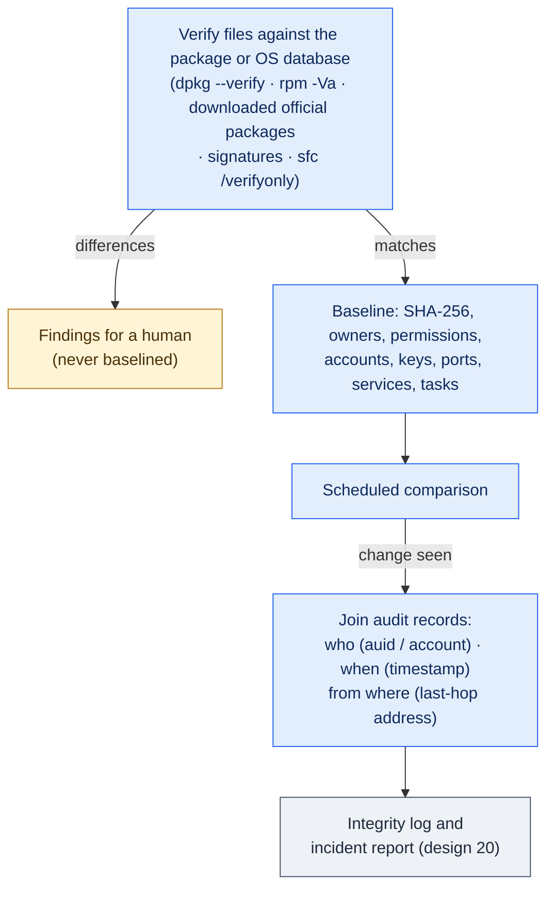

# 08. Baseline and Integrity

Phase: 🟦 Observe (baseline and comparison) and 🟧 Harden (verification against official packages, section 2.1) · Priority: P0 (first baseline), P1 (continuous)

## 1. Goal

Know what a host looks like, then learn quickly what changed, who changed it, when, and from where. This information feeds the incident reports (design 20) and the decoy and status systems.

> [!NOTE]
> Nothing in this design is built yet. The baseline, the package verification, `labyrinth seal` and `labyrinth reseal` are all planned.

## 2. The trap in "hash everything at minute zero"

A hash baseline taken after the Red Team already has a foothold records the compromised state as normal. So the first step is to verify files against a trusted source, and only then take the baseline.

| Step | Linux | Windows |
|---|---|---|
| Verify against the package or OS database | `dpkg --verify` (Debian family), `rpm -Va` (RHEL, Red Hat Enterprise Linux, family) | Authenticode signature checks; `sfc /verifyonly` (read-only, but slow and CPU-heavy, so schedule it) |
| Record unexplained differences | As findings, not as baseline | As findings, not as baseline |
| Baseline the rest | SHA-256 of critical files, permissions, owners | Same, plus registry autoruns and services |

Configuration files legitimately differ from their packages, so differences in `/etc` are reviewed by a human, not accepted automatically.

### 2.1 Verifying against official packages (Harden phase)

`rpm -Va` and `dpkg --verify` compare the files on disk with hash lists that live on the same host, and root can edit those lists. So, in the Harden phase, behind the first-minute lockdown, a second check compares the files with copies that do not come from the host. It is specified here and built later; the local check above is planned as well.

1. **Choose the packages.** A core set: the OpenSSH server, sudo, PAM, coreutils, util-linux, systemd and the shadow and passwd tools; plus any package whose files the local check above flags.
2. **Download each from the host's configured repositories** (`apt-get download` on Debian and Ubuntu, `dnf download` on the RHEL family). The downloads go through design 02's install path, the public software download that design 02 allows after the lockdown, because outbound traffic is closed otherwise; no new repository is added. If the repositories cannot be reached, the offline fallback below is used.
3. **Check the signature.** `rpm -K` on the RHEL family. `apt` verifies the repository's signatures and the package hashes during the download.
4. **Compare** the hashes of the files inside the downloaded package with the files on disk.

**Offline fallback: the reference hash pack.** When the downloads fail, the same comparison runs against a pack made earlier. Before the event, with internet, a Labyrinth script downloads the official packages for the core set above for each target OS release, checks each package's signature, and records every file's hash into a *reference hash pack*. The pack covers every version published for that release, because the exact version on an image is not known in advance: the Ubuntu and Debian archives keep old versions, and Rocky's vault keeps older ones. The pack ships with its own SHA-256, like a release (design 21, section 5), and the SHA-256 goes into the offline record. At the event, when the downloads fail, the Harden phase compares the files on disk with the pack instead. Which OS releases get packs is a run-time choice; the packs and their release list are never committed to the repository. This is specified now and built later.

**Second offline check on Debian and Ubuntu.** Any `.deb` file left in `/var/cache/apt/archives` can be checked against the signed package indexes (apt's `Packages` files, whose signature `apt` verifies) and then compared with the files on disk.

A mismatch is a finding for a person, never an automatic fix: the module does not replace the file. The downloaded packages are temporary files under Labyrinth's own state path and are removed by `cleanup`. Windows keeps the Authenticode signer checks and `sfc /verifyonly` from the table above.

## 3. What is baselined

- Critical files: authentication configuration, SSH (Secure Shell) configuration, sudoers, cron and timer definitions, service unit files, web server configuration, startup items.
- **Boot-critical files**, watched more closely because deleting one and rebooting can leave a host unbootable: `/etc/fstab`, the bootloader configuration (`/boot/grub*`, `/etc/default/grub`), `/etc/passwd`, `/etc/shadow`, `/etc/group`, the systemd default target, and on Windows the boot configuration and the start type of core services. Each has an auditd watch or object-access audit, and a copy is kept off the host with the restore points (design 07, section 5) for the rescue runbook (design 07, section 6).
- Accounts, groups, authorized keys, listening ports, running services, scheduled tasks.
- Firewall state.
- Windows: local administrators, autoruns, services, WMI (Windows Management Instrumentation) subscriptions, scheduled tasks.

The baseline is stored under the state path (design 00). Baselines are compared, never silently overwritten.

### 3.1 The inventory and the dependency map

The inventory module (`lockout.inventory`, Tier 0) records what the host has, read-only and with the operating system's own tools only (design 22, section 4.1). It is the first module of the Lock out phase, so it runs before any change: the map must see the scored services' connections before the default deny cuts them. A runner picks a phase's modules by the start of their ID, so a module in another phase would run only after the lockdown. It writes its files only in a run (`-r`), in the recording call the runner makes to a read-only module's `check` with `LAB_DRY_RUN=0` before the first change (design 00, section 4); a preview prints what it found and writes nothing. Later inventories, taken by the drift check (design 19, section 4.1), are compared with the first.

- **The inventory.** One JSON-lines file per run, `<root>/state/inventory/<UTC time>.jsonl`, one record per line with a `kind` field: `user`, `group`, `sudoers`, `key` (an authorized key, by fingerprint), `listener` (protocol, address, port, process, PID and its systemd unit or Windows service), `service`, `task` (cron, timers, scheduled tasks), `startup`, `package`, `firewall` and `connection`. It is for people to read and for the drift check (design 19, section 4.1) to compare; no module changes anything because of it alone.
- **The dependency map** is `<root>/state/inventory/deps`, one line per outbound connection a scored service had open, in the same column order as `outbound-allow`, so the firewall reads both with one parser:

  ```
  # service   address      proto  port  process
  web-main    192.0.2.15   tcp    5432  apache2
  web-main    192.0.2.40   tcp    389   apache2
  ```

- **Which processes belong to a scored service.** For each line of `services`, the module finds the local listener on its port; a service with no local listener is not on this host. On Linux the service is that listener's whole systemd unit; with no unit, the listener and its child processes. A listener held only by the init process (systemd socket activation) never seeds the set: the module maps the socket unit to its service and uses that service's processes, and records none when it cannot. On Windows it is the listener's Windows service and its child processes; for a site that IIS serves through HTTP.sys, where the listener is the System process, it is the worker processes (`w3wp.exe`) of the application pool of the IIS site whose binding has that port, found by the pool name on the worker's command line. A System-held port that matches no site binding (445, WinRM) records no processes and the module notes it.
- **Which connections count as outbound.** An established TCP connection, or a connected UDP socket, owned by one of those processes, whose remote address is not loopback and whose local port is not one the host listens on. A connection that comes in to a listening port is a client of the service, not a dependency.
- **The map only grows.** A later inventory adds what it newly sees and never removes a line, because after the lockout a real dependency may be blocked and so not seen. A person removes a line by hand.
- **A snapshot, not a watch.** The inventory runs before the lockout, and Red Team acts in the first minute, so it does not wait and watch. A dependency used only now and then, such as a database a page reaches only when it is loaded, may be missed; the probes after the lockout catch the break, and the module is rolled back (design 03, section 6.1). DNS lookups seldom show as connections; the resolvers come from `outbound-allow`.

### 3.2 Reopening outbound from the map

The map cannot tell a real dependency from an intruder's connection back home: a web shell running inside the web server makes its connection as the web server, and Red Team can be inside a service within the first minute (design 03, section 6.1). So the Harden phase, when it reopens outbound (design 03, section 6, step 7), treats each line by where it goes:

- **Inside the team's own networks** (`own-ranges`, Conventions section 2.2): reopened automatically, as a Tier 2 change with probes and the revert timer. A scored service's database, directory or mail relay is almost always here, so scoring keeps working without waiting for a person.
- **Anywhere else:** a Tier 3 item in the approval queue, such as `web-main wants 198.51.100.7 tcp 443 (apache2)`, for a person to allow or leave blocked. An address nobody recognizes is a lead for the persistence sweep (design 06).
- **No `own-ranges` list:** every line is queued.

**A copy off the host.** An attacker with root or SYSTEM on a host can edit the baseline there, hiding a change, and can edit a hash stored next to it just as easily. So right after the baseline is taken, the control node keeps a copy, or at least its SHA-256, away from the host. Every comparison first checks the host's baseline against that copy. A mismatch is itself a high-ranked finding, and the comparison then uses the control node's copy. In local mode with no control node, the operator records the hash in the team's offline record (design 04, section 2).

## 4. Who, when, from where

| Question | Linux | Windows |
|---|---|---|
| What changed | Hash mismatch, plus auditd file watches on the critical set | Event 4663 object access, Sysmon file events |
| Who | auditd `auid` (login identity that survives `sudo`) | Security event account fields |
| When | Event timestamp | Event timestamp |
| From where | Join `ses` to the `USER_START` record, which holds the source address | Join event 4663 to logon event 4624 by logon ID |

> [!IMPORTANT]
> **Caveat.** The address is the last hop the host saw. Through NAT (network address translation) or a proxy it may not be the true origin. Reports say so (design 20).



*Figure: files are first checked against the package database, only clean results become the baseline, and a later change is joined to audit records to show who changed it, when and from which address. Blue steps are automated observation, amber marks work handed to a person, and gray is where the results are stored.*

## 5. Logging that makes this possible

- **Linux:** auditd rules for the critical set, kept small to avoid log floods.
- **Windows:** object access auditing on the critical set, process creation with command line, and Sysmon if it is available inside the environment. Only tools available to all teams and within the rules may be used (National Collegiate Cyber Defense Competition [NCCDC], 2025, Rule 5.1).
- **All hosts:** every host forwards a small set of high-signal events first (design 14).

## 6. Sealed baseline and continuous integrity

The first baseline is taken before the lockout, so it records the host as it was found, which may already include an attacker's changes. Comparing against it later would hide those changes and flag every one of ours. So, once the lockout and the persistence sweep (design 06) are finished and verified, the team **seals** the baseline:

- `labyrinth seal` (planned) takes a new baseline of the cleaned host, after package verification as in section 2, and marks it as the reference. Its hash goes into the team's offline record and a copy goes off the host, as in section 3.
- `labyrinth reseal` (planned) `--reason "<reason>"` replaces the seal after a deliberate change, such as a patch (design 10) or an approved service-pack setting (design 11). The reason is required.
- Every seal and reseal is logged with its time, the operator and the reason, so a reseal that hides an attacker's change can be traced.

Then:

- Scheduled comparison, and every checkpoint (design 19), compares against the **latest seal**; results go to the `integrity` log category.
- Findings are ranked: changes to boot-critical files, authentication, SSH, sudoers, accounts and scheduled execution rank highest, and any new persistence item after the seal is high-ranked (design 06, section 7).
- A change made by Labyrinth itself is recorded in the run manifest and excluded from alerts.
- **Planted marker files.** Some events place files on the hosts that the Red Team copies, changes or deletes to prove it was there, and score their presence (*Background*). A file the sealed baseline holds that is later changed, renamed or removed is an integrity finding like any other, high-ranked when the operator lists its path as a marker in the run-time configuration. Labyrinth never moves, rewrites or deletes such a file, and never creates one.

## 7. Rules check

Read-only observation does not affect scored services and needs no special permission. Auditing must not disable or slow a scored service, so watch lists stay small (NCCDC, 2025, Rule 4.11).

## 8. Acceptance tests

- A file modified by hand in the lab is flagged with account, time and source address.
- A binary replaced with a trojan is caught by the package verification step, not baselined.
- A core-package file edited on a lab host, with the host's own hash list edited to match, is still flagged by the comparison with the downloaded official package, and nothing is replaced automatically.
- With the repositories unreachable, the comparison runs against the reference hash pack; a pack whose SHA-256 does not match the offline record is refused. With neither available, the comparison is skipped, the plan says so, and the local check still runs.
- A `.deb` in the apt cache whose hash is not in the signed package index is reported as a finding.
- A change made by a Labyrinth module does not raise an alert.
- Editing the baseline file on the host is detected by the check against the control node's copy.
- Taking the inventory changes nothing: no file under `/etc` and no registry value changes.
- A scored service's outbound connection to a lab database appears in the dependency map with the service's name; a client connected to the service does not.
- A later inventory never removes a line from the dependency map.
- When outbound is reopened, a map line inside `own-ranges` is allowed automatically, a line outside it is queued, and with no `own-ranges` list every line is queued.
- After `labyrinth seal`, a cron job planted in the lab is reported at the next checkpoint, while the changes the lockout made are not.
- `labyrinth reseal` without `--reason` is refused, and each seal is logged.
- Deleting `/etc/fstab` on a lab host raises a high-ranked alert before any reboot.
- Changing a file listed as a marker raises a high-ranked finding, and no Labyrinth command changes or removes that file.


- Baseline comparison completes within the target time on the lab host.
- Auditing on the critical set does not measurably slow a scored service probe.

## References

National Collegiate Cyber Defense Competition. (2025, December 10). *Rules and requirements*. Retrieved October 2, 2026, from https://www.nationalccdc.org/rules.html
