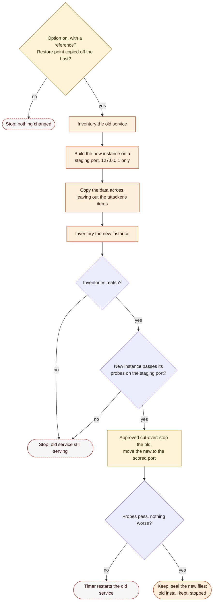

# 13. Service Replacement and Containers

Phase: 🟧 Harden · Priority: P1 · Off by default

## 1. What it is

A guarded way to rebuild a scored service when it cannot be fixed where it stands: a clean install of the service on the same host, or the service in a container on that host. The rebuild keeps the service's address, port, host name, DNS name, content, data and users, so the scoring engine and the service's users see the same service as before.

The national rules forbid migrating or containerizing a scored service unless an inject or the local competition rules allow it (National Collegiate Cyber Defense Competition [NCCDC], 2025, Rule 4.14), and the local rules differ from event to event (NCCDC, 2025, Local Competition Rules section). Where they allow it on the same host, keeping the same public address and DNS name, this design uses it. So everything here is **off by default**. It is turned on by the operator only when the event's own rules or an inject allow it, and every step is an approval item (design 03, section 5, Tier 3).

Without this design, the only answers to a service that is badly compromised or cannot be patched are a slow clean-up by hand or the event's own recovery service, which can cost points and may restore an image that loses every change the team made (design 07, section 6). Snapshots and reverts may not be available at all, so nothing here relies on them. A rebuild from known-good software, with the service's data checked across, is often faster and leaves nothing of the attacker's behind.

## 2. The rules that shape it

| Rule | Effect |
|---|---|
| Teams may not migrate or containerize a scored service unless an inject or the local competition rules allow it (NCCDC, 2025, Rule 4.14). | Off by default. Each module refuses (`20`) unless the run-time `event.conf` turns the option on (section 3). The operator records which inject or local rule allows it, and the manifest keeps that reference. |
| Local competition rules are unique to each event (NCCDC, 2025, Local Competition Rules section). | Nothing here assumes one event's limits. The settings say only what is allowed; the team reads its own event's rules and sets them. |
| Changing a system to make the scoring engine assess a service as operational when it is not can bring disqualification or penalties (NCCDC, 2025, Rule 9.3). | A replacement must really serve the same content and logins. It is never a stand-in that answers the check while the real service is down, and it is cut over only after its own probes and the data check pass (section 5). |
| Any team action that interrupts the scoring system is the team's responsibility and lowers the score (NCCDC, 2025, Rule 9.3). | The old service keeps serving until the new one has passed every check on a staging port. The cut-over itself is one short stop and start under a revert timer. |
| Team tools may not use resources outside the competition environment other than simple DNS lookups (NCCDC, 2025, Rule 5.6.4); free public sources are allowed and private staging areas are not (NCCDC, 2025, Rules 5.1, 5.2). | Software and images come only from the sources design 02 allows: the host's repositories, an event mirror or proxy, a download pinned by SHA-256, or a public registry with the image pinned by digest. Never a team-controlled registry. |
| Tools must not deliberately break expected functionality (NCCDC, 2025, Rule 5.6.5). | One service on one host at a time. The old install and its data are kept, stopped, never deleted, so the change can be undone. |

**Design choices** (stricter than the rules, and not cited as rules):

- **Same host, same identity.** A replacement stays on the host that ran the service, at the same address, port, host name and DNS name. Moving a service to another host is not offered, even where an event would allow it, because it changes the network the scoring engine and the officials know.
- **Same users, same names.** Usernames are never changed, and the users' passwords move with their data. A user who cannot log in after a rebuild has lost their service as surely as if it were down.
- **Full proof before cut-over.** A replacement, including a different product serving the same role, is allowed only with proof that nothing a user or the scoring engine relies on is lost: the same users, the same mailboxes and message counts, the same pages (compared by hash), the same database contents, and the scored check passing against the new service on a staging port before cutover. If any of these cannot be shown, the module refuses (`20`).

## 3. Turning it on

Two run-time keys in `event.conf` (Conventions, section 2.2), both off unless set:

| Key | Allows |
|---|---|
| `ALLOW_SERVICE_REPLACE` | Rebuilding or replacing a scored service on the same host, without containers, with the full proof in section 2 |
| `ALLOW_CONTAINERS` | Running a scored service, or a service an inject adds, in a container on the same host. Implies `ALLOW_SERVICE_REPLACE` for that service |

Each key takes `yes:<reference>`, and is off when unset or `no`. The reference names the inject or local rule that allows it (for example `yes:inject-7` or `yes:local-rules`). A bare `yes` is refused, so the manifest always says why the option was on. Neither key is ever set in a shipped profile or a pre-approval rule: a first-minute run cannot replace anything.

## 4. When it is worth it

A replacement is the last of three choices, after mitigating in place and patching in place (design 09, section 5). Labyrinth offers it, as an approval item, only when one of these holds:

1. **No fix in place.** The tracker holds an open, known-exploited flaw on a scored service with no mitigation in the catalog and no update the host's sources offer (design 09).
2. **Too far gone.** The persistence sweep or the integrity check has found the service's own files changed (a modified binary, a planted module, a web root with unexplained executable files), and a clean-up would take longer than a rebuild (designs 06, 08).
3. **Asked for.** An inject asks for a new service, or for an existing one in a container. A new service is added to the run-time `services` file first, so the firewall and the probes know it (design 03, section 6.1).

The plan shows the reason, the restore point it would start from and how long the last lab rehearsal of that service took (section 9). If the service passes its probes and a patch or mitigation exists, a replacement is not offered.

## 5. The data-preservation check

The core of this design. Before the rebuild, Labyrinth takes an **inventory** of the service as it is; after copying the data into the new instance, it takes the same inventory of the new one; the cut-over is refused (`20`) unless the two match. The inventory is read-only and is also kept as evidence (design 20).

| Service type | The inventory records | Match rule |
|---|---|---|
| Web content | Every file under the content roots, with its size and SHA-256; the scored page's expected content string from `services` | Every file present with the same hash, apart from files the plan lists as the attacker's, which are left out and kept as evidence |
| Database behind a service | Each database and table, with its row count and a checksum from the database's own tool (for example `CHECKSUM TABLE`, or the hash of an ordered dump of the table); the database's users and their grants | Every table, user and grant present; row counts and checksums equal |
| Mail | Each mailbox, with its message count and total size; aliases and forwarding; the mail users | Every mailbox, alias and user present; each count at least what it was, since mail can arrive during the copy |
| Files served over FTP or a share | Every file, with its size, SHA-256, owner and permissions | Every file present with the same hash, owner and permissions |
| Users of the service | The account names the service authenticates (system accounts it uses, the app's own user table, the directory group it reads) | Every name present, unchanged; a user's password or hash carried across, never reset |
| How it answers | Address, port, protocol, the TLS certificate's subject and fingerprint, and the version banner where scoring may read it | Same address, port and protocol; the same certificate and key, copied across; any banner change listed in the plan |

The inventory reads data with the service's own tools, as the operator, and never logs in with a scoring account (design 03, section 4). A table, mailbox or folder too large to copy within the profile's time limit is reported in the plan, so a person can decide before anything starts.

## 6. Sequence

Every step after the first is under a revert timer re-armed before it (design 03, section 8).

1. **Check.** The option is on with a reference (section 3); the service is in `services`; a restore point exists and its off-host copy is confirmed (design 07, section 5); the disk has room for a second copy of the data.
2. **Inventory the old service** (section 5).
3. **Build the new instance beside it**, on a staging port bound to `127.0.0.1` only, from the allowed sources (design 02). The old service keeps serving.
4. **Copy the data** from the restore point, or from the live service with its own export tool, leaving out the items the plan lists as the attacker's.
5. **Inventory the new instance** and compare. A mismatch stops here, with the difference listed; nothing that scoring sees has changed.
6. **Probe the new instance on its staging port** with the same scoring-style probes, content check and logins as the real one (design 19, section 3).
7. **Cut over.** Stop the old service and set it not to start; move the new one to the scored port; run the probes from the host and, where configured, from outside (design 19, section 3).
8. **Keep or revert.** The run is kept once verify passes and no scored service that passed before is worse (design 00, section 4). Otherwise the timer stops the new instance and starts the old one again, untouched.
9. **Seal.** The new instance's files go into the baseline (design 08, section 6), and the old install stays on disk, stopped, until the end of the event. Removing it is a cleanup item (design 21).

*Figure: a replacement starts only with the option on and a restore point copied off the host, is built and checked beside the old service, and takes over the scored port only once its data matches and its probes pass. Orange is Harden work, amber a person's approval and dashed red outlines the points where the old service keeps or resumes serving.*

## 7. Containers

Where `ALLOW_CONTAINERS` is on, the new instance in section 6 may be a container. The extra rules:

- **Runtime.** Installed by the `packages` module from the distribution's own repositories only, after approval (design 02), with no new repository: Podman on the RHEL family (rootless-capable), Docker from the distribution repositories (`docker.io`) on Debian and Ubuntu. Never a vendor install script.
- **Images.** From a public registry, named by digest (`image@sha256:…`), never by a tag alone, since a tag can change after it was tested. The digest is in the release's catalog or in the approval item, so what runs is what the team reviewed.
- **Least privilege.** Every container runs as a non-root user by default, drops ALL capabilities and adds back only those the service needs, sets `no-new-privileges`, uses a read-only root file system where the service allows (with a temporary file system where it writes), and is never `privileged`, never given the container engine's socket, and never given the host's network, process or other namespaces. Bind mounts are limited to the service's data and configuration folders on an allowlist, checked before the container starts (Blueprint §3.7).
- **Named exception to non-root.** Services built to start as root and drop privileges themselves (Postfix and Dovecot) may start as root inside the container. The exception list is named in the catalog; any other container that would run as root is refused.
- **Ports below 1024.** Published from a high port inside the container, so the container needs no capability to bind them. Rootless Podman cannot publish a host port below 1024, so on the RHEL family a container on such a port is started by root-run Podman with the service inside running as a non-root user (`--user`); the system-wide `net.ipv4.ip_unprivileged_port_start` setting is never lowered, because that would let any local user bind those ports.
- **Same identity.** Same host, same public address, same DNS name and same usernames; the scored check passes before cutover (section 6).
- **Data stays on the host.** The service's data lives in a host folder mounted into the container, so restore points (design 07) and the integrity check (design 08) cover it, and removing the container never removes the data. On SELinux hosts the mount is relabeled for the container (`:Z`).
- **The firewall still applies.** Docker's published ports are handled in the `DOCKER-USER` chain, before the host's own input rules, so a published port bypasses UFW and firewalld. The firewall adapter therefore adds bans and the outbound rules to `DOCKER-USER` as well, includes it in its snapshot and `state` (design 01, section 5), and publishes only the scored port. Any other port the container opens is bound to `127.0.0.1`. Podman's rootless ports go through the host firewall normally.
- **Logs.** The container logs to the host's journal, so log forwarding picks them up (design 14).
- **Restart.** The container restarts on failure and at boot, so a power cycle brings it back with the host.

## 8. What it will never do

- Replace or containerize anything while its option is off, or on without a reference.
- Replace a service without the full proof in section 2.
- Change a service's address, port, host name, DNS name or the usernames of its users.
- Move a service to another host.
- Delete the old install, its data or a restore point.
- Cut over with a failed inventory match or a failed probe.
- Pull an image by tag alone, or from a private or team-controlled registry.
- Run a container privileged, as root outside the named exception list, with the engine's socket, with the host's network or process namespace, or with a mount outside its allowlist.
- Publish a port that is not in `services`.
- Run in a first-minute run, or from a pre-approval rule.

## 9. Rehearsal

A rebuild done for the first time at an event is a gamble. Each service type a team may rebuild is rehearsed in the lab (`docs/lab/README.md`), from a restore point to a passing probe, and the time it took is recorded there. The plan in section 4 shows that time, so the person approving can compare it with the time left and with the cost of the event's own recovery service.

## 10. Acceptance tests (in the lab)

- With both options off, every module of this design refuses (`20`) and changes nothing; with a bare `yes`, it refuses with a message naming the missing reference.
- A web service with a planted file is rebuilt: every listed content file matches by hash, the planted file is left out and kept as evidence, and the content probe passes on the same address and port.
- A database table with one row removed in the copy fails the inventory match, the cut-over does not happen, and the old service is still serving.
- A mail service is rebuilt with every mailbox, alias and user present, and a test user still logs in with the same password.
- A replacement whose pages, mailboxes or database contents do not all match is refused, even when the new service is a different product serving the same role.
- A deliberately failed probe after the cut-over makes the timer stop the new instance and start the old one, and the old one passes its probe.
- A containerized service runs as a non-root user with no added capabilities, and a container definition with `privileged`, a host network, the engine's socket, or root outside the named exception list is refused.
- A container for a port below 1024 publishes it from a high port inside the container.
- On a Docker host, a banned address cannot reach the container's published port, and a port the container opens for itself is reachable only from `127.0.0.1`.
- An image named by tag alone is refused.
- After a power cycle of the host, the containerized service is back and its probe passes.
- No run of this design changes a host name, an address or a username, before or after.

## References

National Collegiate Cyber Defense Competition. (2025, December 10). *Rules and requirements*. Retrieved October 23, 2026, from https://www.nationalccdc.org/rules.html
