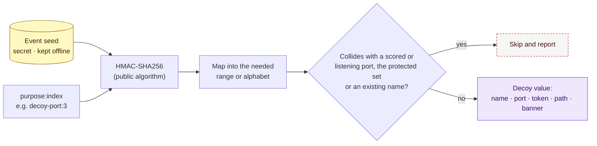

# 16. Event Seed and Deception Configuration

Phase: 🟪 Deceive · Priority: P1

## 1. The problem

Team-written tools must be public before use and frozen (National Collegiate Cyber Defense Competition [NCCDC], 2025, Rules 5.6.1, 5.6.2), and shared with all teams (NCCDC, 2025, Rule 5.6.3). Rivals and the Red Team can read the code. If decoy names, ports, canary tokens or trap locations are fixed in the code, the Red Team can learn to avoid them.

## 2. The idea in plain terms

The code is public. The values are not in the code. Kerckhoffs's principle says a system should stay secure even when everything except the key is known. Here the "key" is a short random value, a **seed**.

- The **algorithm** (how a seed becomes decoy names, ports and tokens) is public.
- Each host makes its own **decoy seed** at the event (section 4.1), so each host's decoys differ. A pattern repeated on every host would mark the decoys, and root on one host would expose them all; with a seed per host, it exposes only that host's.
- The seeds are secret. Each is kept on its own host and in the team's offline record (design 04, section 2), and shared only through the official team chat or in person.
- The same seed always gives the same values, so a teammate holding a host's seed can work out that host's decoys on any machine, without a shared secrets file.
- Scored-account passwords need the same value on every host, so they come from a separate **team seed**, the same on every host (design 04, section 2.4).

A rival who reads the repository learns how values are made, not which values any host uses.

## 3. Derivation

`value = HMAC-SHA256(key, "purpose:index")`, then mapped into the needed range or alphabet (section 3.2). The key is the seed's 28 random characters as ASCII bytes; the check group is not part of it. HMAC-SHA256 (a hash-based message authentication code using SHA-256) is a keyed hash: the same seed and label always give the same output, and the output reveals nothing about the seed.

| Purpose string | Produces |
|---|---|
| `decoy-user:N` | Honey-account names (chosen from a public word list) |
| `decoy-port:N` | Trap port numbers (from an allowed range that excludes scored ports) |
| `canary-token:N` | Canary file contents and markers |
| `decoy-path:N` | Decoy file and directory names |
| `ssh-banner:N` | Banner text variants |
| `scored-admin:<username>` | The new password of a `scored-admin` account, from the **team seed**, so it is the same on every host that has the name and the team can work out the change list on its own machine (design 04, section 2.4). Never written down by Labyrinth |

Changing `purpose` or `index` gives unrelated values. Nothing derived can be reversed to the seed.

*Figure: the public algorithm combines the secret seed with a purpose label to produce each decoy value, and any value that collides with scoring or a protected account is skipped. Gold marks the secret, purple the resulting decoy value, and a dashed red outline a value that is skipped.*

### 3.1 Seed format

A seed is 28 random characters and a 4-character check group, written as 8 groups of 4, such as `3LES-4LLU-DG9M-GZ3C-DB9D-LL2D-5YVY-4G4N`.

- **Alphabet.** `23456789ABCDEFGHJKLMNPQRSTUVWXYZ`: 32 characters, leaving out 0, 1, I and O, which are easily mistaken when copied by hand. Each character is exactly 5 random bits, so the 28 give 140 bits.
- **Randomness.** Only the operating system's cryptographic generator: `/dev/urandom` on Linux and `[System.Security.Cryptography.RandomNumberGenerator]` on Windows (random(7), n.d.; Microsoft, n.d.). Never `$RANDOM` or `Get-Random`, which are not cryptographic. Each random byte gives its low 5 bits; 256 is 8 × 32, so every character is equally likely.
- **Check group.** The first 20 bits of SHA-256 of `labyrinth-seed-check:` followed by the 28 characters, written as 4 characters of the alphabet. Labyrinth recomputes it from the first 28 characters typed, so a typo anywhere is caught, except about once in a million. The formula is public and adds no secrecy.
- **Input.** Case, spaces and dashes are ignored. A message about a bad seed says what is wrong, never the seed.

### 3.2 Mapping into a range

A number from MIN to MAX reads the HMAC result 32 bits at a time and throws away a block at or above the largest multiple of the range's size below 2^32; the first block kept, modulo the size, plus MIN, is the value. Taking every block modulo the size would make the low numbers slightly more likely. If all eight blocks are thrown away, the HMAC of `purpose:index#1`, then `#2`, and so on gives more. A range holds at most 2^31 numbers.

### 3.3 Building it

HMAC-SHA256 follows RFC 2104 (Krawczyk et al., 1997). Using a strong random key directly, with a distinct label for each value, is what HKDF calls the expand step (Krawczyk & Eronen, 2010). PowerShell uses .NET's `HMACSHA256`. Bash builds HMAC from `sha256sum`, because openssl is not on every host, and works on hex throughout, because a bash string cannot hold a zero byte. Both are held to the RFC 4231 test cases (Nystrom, 2005) and to one set of expected values, so they give the same results.

## 4. Constraints

- **Never on a scored port.** Derived ports are checked against the scored-service list (`services`) and the host's current listeners, and skipped if they collide (NCCDC, 2025, Rule 9.3). The scoring allowlist holds the scoring engine's addresses, not ports, so it is not used for this check.
- **Never a real account name.** Derived names are checked against the protected set and existing users.
- **Seed strength.** 140 bits from a cryptographic random source, with a check group so a typo is detected (section 3.1).
- **Seed handling.** A seed is never committed and never appears in shell history, the process list or logs, so it is never on the command line. It is kept in `<root>/etc/seed.conf`, never typed at a prompt during a run, and held in memory and cleared after use. The copies are that file, the offline record and the team chat.
- **The seed file.** `seed.conf` holds `DECOY_SEED`, this host's own seed, and `TEAM_SEED`, the team seed (design 04). Labyrinth writes it, root-only (mode 600 on Linux; the data root's Administrators and SYSTEM on Windows). It is kept apart from `event.conf`, which is the same on every host and is copied between hosts, so copying that can never give two hosts the same decoy seed. `seed.conf` is never copied between hosts.

### 4.1 Making and checking a seed

- `sudo laby --new-seed` makes this host's decoy seed, saves it as `DECOY_SEED`, and shows it once on the terminal until the operator types `recorded`, then clears the screen, as a new password is shown (design 04, section 2.3). The operator posts it in the team chat with the host's name. It needs root. Without a terminal it refuses before saving anything, and if the terminal goes before `recorded`, it removes the seed it saved, because nobody recorded it. If the host already has a decoy seed, it asks before replacing it (`-y` answers yes): the decoys made from the old seed are removed and made again from the new one.
- The installer never makes a seed: a seed made at install time would be copied along with the machine or its image, and nobody would be there to record it. Its closing screen names `--new-seed` as a step instead, and the deceive phase refuses to place decoys until the host has a seed.
- `laby --seed-check` asks for a seed at a visible prompt on the terminal and says whether it is a valid seed. It reads no configuration and needs no root, so it works on any machine with Labyrinth, such as the one a teammate scans from.
- Once the decoy modules exist, both also show the seed's planned decoys: each trap port with its backups (the values it moves to when the first collides), canary files and honey-accounts, and a ready-to-paste scanner exclusion such as `--exclude-ports 56086,41007`, so the team's own scans skip them. The deceive preview shows this host's exact list, and `sudo laby --decoys` the decoys it has.

## 5. Why not encrypt the values in the repository

A repository file encrypted with a shared password does not solve the problem:

- the password needs its own distribution;
- the team must have it on every host;
- the file is public ciphertext that can be attacked at leisure.

Deriving values from a seed kept offline removes the stored secret entirely.

## 6. What the seed does not protect

- The seed protects the *choice* of values, not their behavior. A determined attacker who lands on a decoy still sees what it is.
- If a host's seed leaks, or its decoys are found, that host makes a new seed with `--new-seed` and its decoys are made again; other hosts are not affected. Design for that case: redeploying decoys must be a cheap module run.

## 7. Configuration files

`config/*.example` shows the shape (host groups, scored port list, protected set format) with placeholder values only. The real files are created at the event and never leave the control node. The public repository contains no real address, hostname or credential.

## 8. Acceptance tests

- The same seed yields identical values across two machines.
- A different seed yields different values and no overlap beyond chance.
- No derived port is a scored port or a port already listening on the host.
- A seed with a bad checksum is rejected, and the message does not repeat the seed.
- The HMAC code gives the RFC 4231 results, and bash and PowerShell give the same value for each seed and label.
- `--new-seed` refuses without root or a terminal and saves nothing; it removes its seed when the terminal goes before `recorded`, and asks before replacing a seed.
- `--seed-check` accepts a valid seed and refuses a typo, with no root and no configuration.
- A search of the repository for real event values finds nothing.
- The seed never appears in logs or shell history after a run.

## References

Krawczyk, H., Bellare, M., & Canetti, R. (1997). *HMAC: Keyed-hashing for message authentication* (RFC 2104). Internet Engineering Task Force. https://www.rfc-editor.org/rfc/rfc2104

Krawczyk, H., & Eronen, P. (2010). *HMAC-based extract-and-expand key derivation function (HKDF)* (RFC 5869). Internet Engineering Task Force. https://www.rfc-editor.org/rfc/rfc5869

Microsoft. (n.d.). *Get-Random*. Retrieved October 31, 2026, from https://learn.microsoft.com/powershell/module/microsoft.powershell.utility/get-random?view=powershell-5.1

National Collegiate Cyber Defense Competition. (2025, December 10). *Rules and requirements*. Retrieved September 29, 2026, from https://www.nationalccdc.org/rules.html

Nystrom, M. (2005). *Identifiers and test vectors for HMAC-SHA-224, HMAC-SHA-256, HMAC-SHA-384, and HMAC-SHA-512* (RFC 4231). Internet Engineering Task Force. https://www.rfc-editor.org/rfc/rfc4231

random(7). (n.d.). In *Linux manual pages*. Retrieved October 31, 2026, from https://www.man7.org/linux/man-pages/man7/random.7.html
