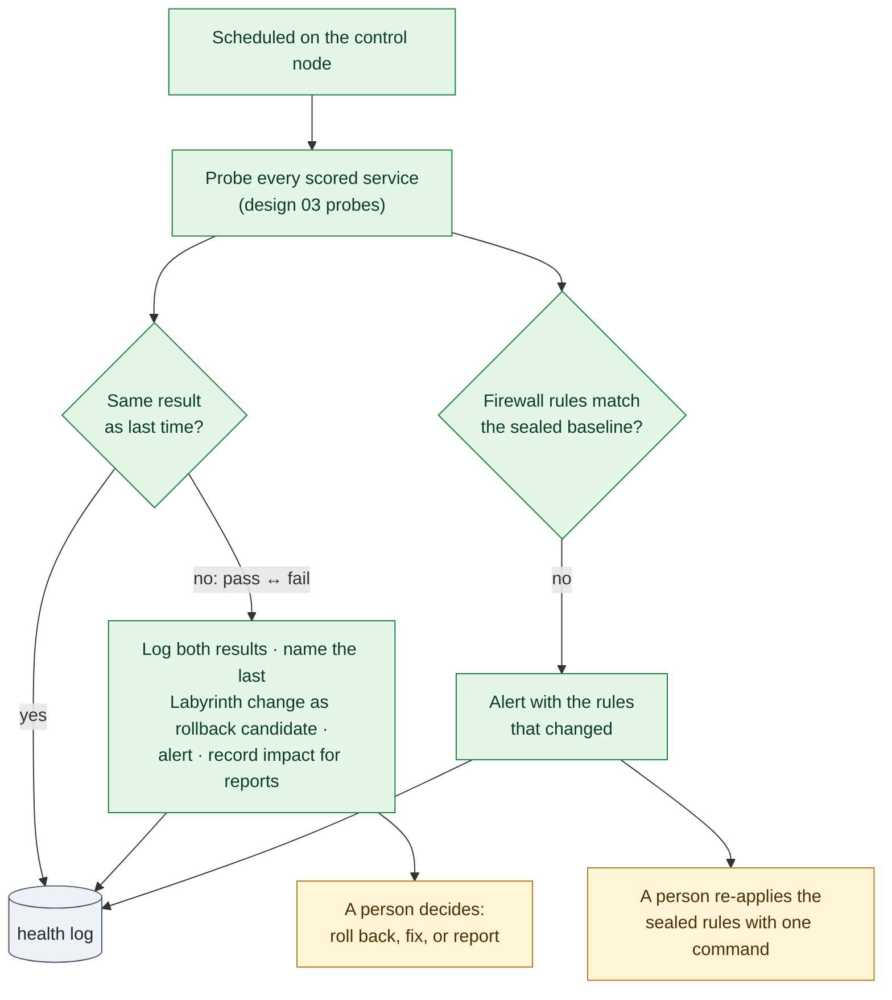

# 19. Health Monitor and Checkpoints

Phase: 🟩 Sustain · Priority: P1

> [!NOTE]
> **Planned.** The health monitor, `checkpoint` and `restore` are not built yet (Roadmap: `restore` in the first usable release, the health monitor and `checkpoint` in the milestone "Observe and checkpoints"); the names and letters of the planned commands are decided when each is built (Conventions, section 3.3). Today `laby --probe` probes every scored service once, and the `http`, `dns` and banner probes exist. The firewall-drift check, the login probes and the scheduled checkpoint arrive with the monitor.

## 1. Goal

Two jobs for the long middle of an event, after the lockout:

1. **Health monitor:** notice within minutes when a scored service stops answering, whoever caused it.
2. **Checkpoint:** one read-only command that sums up the whole network's state, so a team can review it at regular intervals.

Today the scoring-style probes (design 03, section 9) run only when a module finishes. Nothing re-checks a service an hour later, after the Red Team, a teammate or a slow failure has changed it.

## 2. Rules that shape it

| Rule | Effect |
|---|---|
| Anything that interferes with the scoring engine is the team's responsibility (National Collegiate Cyber Defense Competition [NCCDC], 2025, Rule 4.11). | Probes are light: one per service per interval, with short timeouts. |
| Do not mislead the scoring engine (NCCDC, 2025, Rule 9.3). | The monitor never fakes a response or changes what a service returns. |
| Tools must not deliberately break expected functionality (NCCDC, 2025, Rule 5.6.5). | The monitor changes nothing. It alerts, and a person decides what to roll back or re-apply (sections 4 and 4.1). |

## 3. The health monitor

- **Where it runs:** on the control node, as a scheduled job.
- **What it probes:** every service in the run-time service list, using the same probes as the panic button (design 03, section 9). Scoring accounts are never used to log in (design 03, section 4).
- **Only the team's own services.** Probes, from the control node or from a workstation, go only to the team's own services in the run-time service list. Labyrinth never probes or scans another team's systems or anything outside the team's own ranges (NCCDC, 2025, Rule 4.10).
- **How often:** an interval set in configuration. The timing belongs to the team's own plan, not to this public document.
- **Where results go:** the `health` log category (design 00, section 7), forwarded to the SIEM (design 14), and a one-line summary per host in the status feed (design 15).

> [!IMPORTANT]
> **Answering is not logging in.** The probes check that a service answers, not that a user can log in to it, because scoring accounts are never used. A mail service can pass every probe while its logins are broken, and still fail scoring. To narrow this gap, the team may create a test mailbox or user by hand that is *not* a scoring account and add it to the service list with a login probe. The scheduled job does not use that password, so the login probe runs only when an operator starts it, for example with `labyrinth checkpoint` (planned, section 5). The password comes from the private event configuration file (a flag at the start may name the file, never carry the password), never typed during a run, and is kept only in memory, like the event seed (design 16).

### 3.1 Probes that log in and check content

Events differ in what a check does: some only connect, others log in and read a page, a mailbox, a file share, a table or a search result (*Background*). A probe that only connects misses the failures a hardening change is most likely to cause, so the service list may name, per service:

| Kind | What the probe does |
|---|---|
| `http` with a path | Fetches that path, not only `/`, and compares the status and a content string |
| `imap`, `pop3` | Logs in and lists the mailbox |
| `ssh` | Logs in and runs `true` |
| `smb` | Lists a named share |
| `sql` | Logs in and runs a fixed read-only query |
| `winrm` | Opens a session and runs a no-op |
| `siem` | Runs a fixed search through the SIEM's interface |

- **The account.** A probe that logs in uses a probe account the operator creates for the purpose, never a scoring account (design 03, section 4). Its password comes from the private event configuration file, which a flag at the start may name (the flag never carries the password itself, so it stays out of shell history and the process list); it is never typed during a run and is held only in memory (design 16). Where a `scored-admin` account was rotated, the probe uses the new password from the same run (design 04, section 2.4).
- **No account given.** The probe connects only and the plan says so.
- **Read-only.** A probe never writes, sends or deletes anything on the service.

> [!IMPORTANT]
> **Inside is not outside.** The control node probes from inside the network. The scoring engine checks from wherever it sits, often outside, through the edge firewall and NAT. A pass from inside does not prove the scoring engine sees a pass. Where possible, add one probe from the same side as the scoring engine, and trust the official scoreboard over the monitor. `laby --probe` may run from a machine outside the team's network, such as a console the event provides; it then probes only the addresses in the run-time `own-ranges` list and refuses any other, so it never touches a system outside the team's network (NCCDC, 2025, Rule 4.10).

## 4. When a probe changes state

When a service goes from pass to fail, or back, the monitor:

1. writes the change, with both probe results, to the `health` log;
2. looks up the last Labyrinth change on that host in the run manifest and names it as a **rollback candidate**;
3. raises an alert in the status feed and the SIEM;
4. records the outage time for the incident report's "impact on scored services" field (design 20).

It does **not** roll back on its own. During a run, a failed verify triggers automatic rollback (design 00), because the cause is almost certainly the change just made. An hour later, the cause could be the Red Team, a teammate or the scoring side. Blindly reverting could undo a security fix, so a person decides. To restore a damaged service, the person runs `labyrinth restore` (planned; design 07, section 6).

### 4.1 Firewall drift

Red Teams have been seen dropping a team's firewall rules. So each interval, the monitor also compares every host's firewall rules with the set recorded in the sealed baseline (design 08, section 6). When they differ, it logs and alerts on the difference, as a high-ranked integrity finding for the incident record (design 20), naming the host and the rules that changed.

The monitor **never re-applies firewall rules unattended**: putting rules back without a person could cut off an operator or a scored service that the drift itself changed. A person re-applies the sealed rule set with one command, which runs with the same before-and-after probes and revert timer as the original change (design 03, section 8). If the team changed the firewall on purpose, it reseals first (design 08, section 6). Repeated drift on one host is flagged as a sign that the attacker still has admin rights there.

*Figure: the control node probes every scored service on a schedule, and when a result changes it logs both results, names the likely cause and alerts; when firewall rules drift from the sealed baseline it alerts too. Rollback and re-applying rules are left to a person. Green is sustain work, amber the person's decision and gray the log.*

## 5. The checkpoint command

`labyrinth checkpoint` (planned) is read-only and prints one short summary, also saved to the `report` log category:

| Section | Source |
|---|---|
| Scored services: current state and any outage since the last checkpoint | Health log (this spec) |
| Integrity: changes since the latest sealed baseline | Baseline comparison against the seal (design 08, section 6) |
| Persistence: new items, and items still waiting for approval | Persistence sweep in report mode (design 06, section 7) |
| Locked accounts ready to offer for deletion, once every scored service passes | Account module (design 04, section 6.4) |
| Known flaws: open findings by rank, mitigated findings still waiting for a patch, accepted findings with their reasons, and any mitigation that has drifted | Vulnerability tracker (design 09, section 4) |
| Inventory drift: new accounts, listeners, services, tasks | Inventory module (design 22, section 4.1) |
| Open incidents and reports not yet submitted | Report tracker (design 20) |
| Trap trips and active bans | Trip log and ban set (designs 17, 18) |
| Time since the last backup of each scored service | Backup record (design 07) |
| Revert timers still armed | Safety core (design 03) |
| Firewall drift found since the last checkpoint, and whether it was re-applied | Section 4.1 |
| Services with no restore point copied off the host | Backup record (design 07, section 5) |
| Tool integrity: signature and hashes still match | Design 21 |

The command takes no action. It exists so that a regular review is quick and every review covers the same ground.

**On a schedule.** The monitor also runs `checkpoint` on each host on an interval set in configuration, as the same scheduled job on the control node. It is read-only, like the command, and leaves out the login probe, because the scheduled job does not use the probe password (section 3). When a section shows something new since the last scheduled checkpoint, the monitor raises one alert in the status feed and the SIEM, naming the host and the section: a new persistence item, an integrity change, a mitigation that has drifted, a new open flaw in rank groups 1 to 3, a new account, listener, service or task, or a revert timer left armed longer than its run. A finding that is still there next time does not alert again, and every scheduled summary is saved to the `report` log category for the next person who reviews it.

## 6. Failure behavior

- If the monitor stops, the status feed marks its data stale (design 15), so silence is never mistaken for health.
- A probe that times out counts as a fail, never as a pass.
- The monitor never blocks a login or a Labyrinth run.

## 7. Acceptance tests

- Stopping a scored service in the lab raises an alert within one interval, naming the last Labyrinth change on that host.
- Restarting it logs the recovery and the outage length.
- The monitor never runs a rollback, a restart, a firewall re-apply or any other change.
- Flushing a lab host's firewall is detected within one interval and raises an alert naming the changed rules; the monitor does not re-apply them, and the one command a person runs puts the sealed rules back with every probe still passing.
- `labyrinth checkpoint` completes on the full lab network within the target time and changes nothing (the inventory before and after is identical).
- A scheduled checkpoint changes nothing; a planted listener raises one alert naming the host, and the next scheduled checkpoint does not raise it again.
- Killing the monitor marks the status feed stale.
- Probe traffic is under the target rate per service.
- With a test mailbox configured, breaking mail logins in the lab makes the checkpoint's login probe fail even though the banner probe still passes.
- An `http` probe with a path fails when that page's content string is missing, though `/` still answers.
- `laby --probe` refuses an address outside `own-ranges`, and refuses to run with no `own-ranges` list.

## References

National Collegiate Cyber Defense Competition. (2025, December 10). *Rules and requirements*. Retrieved October 2, 2026, from https://www.nationalccdc.org/rules.html
