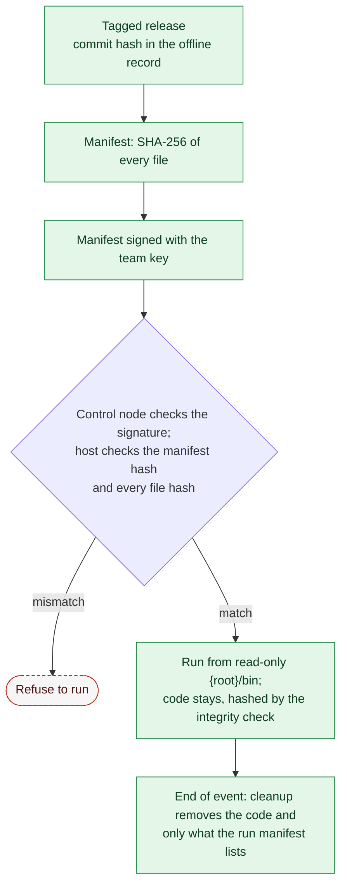

# 21. Cleanup and Tool Integrity

Phase: 🟩 Sustain · Priority: P1

## 1. Two goals

1. **Cleanup:** when the event ends or a module is removed, leave no stray files, timers, rules or accounts.
2. **Tool integrity:** know that the Labyrinth code on each host is the code that was released, and that nobody changed it.

## 2. Cleanup (planned)

Cleanup and the signature check are planned (Roadmap milestone "Reporting and cleanup"). Today each host's own release check (section 5.1) is built, and `rollback` undoes a run.

- Every module lists its `outputs` in `module.yml` (design 00), and every `apply` writes to the run manifest.
- `cleanup` removes temporary files; `rollback` undoes changes. They are separate so the operator can clean up without reverting.
- End-of-event cleanup removes revert timers, scheduled tasks, temporary accounts and Labyrinth's copied code from hosts, but keeps logs and reports until they are collected. The copied code includes what the installer added (Conventions, section 3.3): on Linux the links `/usr/bin/laby` and `/usr/bin/labyrinth` and the manual in `/usr/local/share/man/man1/`; on Windows the `C:\Program Files\Labyrinth` folder, its entry on the machine `PATH` and the `Labyrinth` help module folder in `C:\Program Files\WindowsPowerShell\Modules`.
- **Accounts.** The only accounts cleanup ever deletes are ones Labyrinth itself created, such as honey-accounts (design 17), and recorded in the run manifest when it created them. Cleanup never deletes an account that existed before Labyrinth ran; deleting an unexpected account is a separate, approved step during the event (design 04, section 6.4). Domain honey-accounts, created by hand (design 12, section 5), are removed by hand too.
- Cleanup never deletes evidence or anything the manifest does not list. The quarantine area (design 06, section 5) and saved account evidence are evidence: they are kept, like logs and reports, until they are collected.

- Cleanup only touches Labyrinth paths (design 00 standard paths).

## 3. Materials handling

Competition materials, including team-generated reports and documents, must stay in the competition area, and nothing may be removed without authorization (National Collegiate Cyber Defense Competition [NCCDC], 2025, Rules 4.4, 8.5). Collect logs for the debrief only as far as those rules and the officials allow.

## 4. Rejected: encrypted script folder with a shared password

The earlier idea was an encrypted folder, decrypted with a shared team password. It was rejected because:

- The password has to be distributed and typed on every host, which creates the leak it is meant to prevent.
- The team's own code must be public anyway (NCCDC, 2025, Rule 5.6.1), so there is nothing to hide.
- Encryption gives confidentiality, not integrity. The real risk is tampering, not reading.

## 5. Replacement: signed manifest and known commit

| Control | How |
|---|---|
| Release identity | A tagged release with a commit hash. The hash is kept in the team's offline record (design 04, section 2) and matches the declared release (NCCDC, 2025, Rule 5.6.2). |
| Manifest | A list of every file with its SHA-256, generated at release time. The manifest's own SHA-256 is kept in the offline record. |
| Signature (planned, milestone "Reporting and cleanup") | The manifest is signed with a team key, using `ssh-keygen -Y sign`. The public key is kept in the offline record and stored on the control node. |
| Immutable location | Code sits in a root-owned, read-only directory on each host (`<root>/bin` on Linux, `C:\Program Files\Labyrinth` on Windows), put there by the installer, which makes the same check of the folders above before it writes anything and refuses if it fails (Conventions, section 3.3). The core checks this before every `laby -r`, `-k` and `-u`, the revert timer's included: the code folder, the configuration folder and the data root, everything in them, and every folder above them must be changeable only by root (Linux) or by administrators, SYSTEM and TrustedInstaller (Windows). On Linux that means owned by root and not writable by group or others; a folder above may be writable if it is sticky, like `/tmp`. Otherwise the command refuses with 20 and changes nothing. The check only reads: Labyrinth never changes the owner or permissions of its own code. The revert timer runs `labyrinth.sh` from the real path, with links resolved. |
| Verify before run | The control node checks the manifest signature before every run. On each host, the runner checks every file against the manifest before it loads any of the core (below), and prints the manifest's SHA-256, which the operator compares by eye with the value in the offline record. |
| Code stays until cleanup | Labyrinth's code stays in its code folder until end-of-event cleanup removes it, because the revert timer runs from it and needs it present. Nothing is pushed, run and deleted. |

**Why the signature is checked only on the control node.** `ssh-keygen -Y verify` needs OpenSSH 8.1 or later. RHEL 8 ships 8.0, and the OpenSSH bundled with Windows Server 2019 is older still (*Background*), so a host may not be able to check a signature at all. The control node can be chosen to have a recent OpenSSH; hosts only need SHA-256, which they all have. In local mode with no control node, the operator checks the manifest hash by eye against the offline record.

### 5.1 The release check on each host

The manifest is `release.sha256` in Labyrinth's folder: one `<sha256>  <path>` line per file, the format `sha256sum -c` reads, with paths relative to the folder and `/` between folders. It covers `labyrinth.sh`, `labyrinth.ps1`, the installers `install.sh` and `install.ps1`, the Windows launchers `laby.cmd` and `labyrinth.cmd`, and every file under `core`, `phases`, `platform`, `profiles`, `vendor`, `config` (the templates) and `manual` (the man page `labyrinth.1` and the help topic `about_Labyrinth.help.txt` that `tools/manual/build.sh` writes, when the release has them; a plain git checkout does not). The installer copies exactly these files, and the list with them, into the code folder, so the installed copy is checked like the release it came from. `tools/release/manifest.sh` (or `manifest.ps1`) writes it into the copy that will be deployed and prints its SHA-256, which the team captain records in the offline record. The copy then goes to the hosts byte for byte: a checkout that changes line ends changes the hashes.

- **When.** Every command, before the runner loads the rest of the core: `core/safety/release.sh` and `core/safety/Release.ps1` need nothing else, so a changed core file is found before any of it runs. The revert timer's `-u` is checked like any other command.
- **What fails.** A listed file that is missing, is a link or differs; a file under the covered paths that the list does not name, such as one dropped into `phases`; a line that is not in the format, names a path outside the folder, or repeats a path; a list that is empty or is itself a link. The command then refuses with `20`, names the first problem, and changes nothing. A refused `-u` also sends a notice to whoever is logged in (`wall`, `msg`), because the run's changes stay in place.
- **No list.** A copy taken straight from the repository has no `release.sha256`. Then `-r`, `-k` and `-u` warn `no release.sha256, so Labyrinth's files were not checked`, and the hash lines say `not checked`. They do not refuse: the operator decides, from the team's notes, whether this copy is the one to run. The installer does the same: it installs such a copy with a note that it was not checked, and a copy whose list does not match is refused.
- **What it shows.** The installer's screen, `-V` and the recap of every run show the SHA-256 of `release.sha256` as two lines of eight groups of four (`SHA-256:` in `-V` and the recap; inside the installer's `WARNING` box), as does `manifest.sh` when it writes the list. The operator compares it with the offline record by eye. Hashes of the release archives are written as `sha256sum` prints them.
- **Its limit.** The check is code in the release. An intruder with root who changes the runner or the check as well can make it print the expected hash. What catches that is a check with the host's own tools, which the manual gives: `sha256sum release.sha256` (or `Get-FileHash`) against the offline record, then `sha256sum -c --quiet release.sha256`. The check on each run catches a changed, planted or missing file, a damaged copy, and a partial update; the host's own tools catch the rest.

The persistence sweep covers what the check does not (design 06, section 3): files in Labyrinth's data root that no run record explains, and look-alike timers and tasks.

Resident components (timers, watchers) are hashed by the integrity check (design 08) like any other critical file.

### 5.2 Getting the release onto a host

Events differ on how a team's code reaches the hosts. Some offer a proxy that reaches the team's declared repository (Blueprint §5, internet access); some give each team a console on a machine that reaches the internet while the hosts do not; some allow neither (*Background*). Labyrinth assumes no control node, so the release is a single file the operator can fetch, or carry in and paste as an offline fallback, and check with each host's own tools. Downloads are the first choice: after the first-minute lockdown the host may fetch public software too (design 02), but the release itself is always checked against the offline record before it is unpacked:

- **The file.** `tools/release/archive.sh TAG` stages the files the release list covers and the built manual in a folder `labyrinth-<tag>`, writes `release.sha256` into it with `tools/release/manifest.sh`, and builds `labyrinth-<tag>.tar.gz` (Linux) and `labyrinth-<tag>.zip` (Windows) with that folder at the top. The files are owned by root, sorted by name, dated with the tagged commit, and writable by their owner only, so one commit gives the same archives each time. It prints the SHA-256 of each archive. The workflow `.github/workflows/release.yml` runs it for every pushed tag `v*` and publishes both archives as release assets, with each archive's SHA-256 and the SHA-256 of `release.sha256` in the release notes; a manual run with a test tag keeps the archives as workflow artifacts and publishes nothing. The SHA-256 of each archive goes into the offline record with the manifest's.
- **Fetching.** On a host that can reach the repository: `curl -fsSLO https://github.com/<repository>/releases/download/<tag>/labyrinth-<tag>.tar.gz`, or on Windows `Invoke-WebRequest -UseBasicParsing -Uri <url> -OutFile <file>` after setting TLS 1.2 (`[Net.ServicePointManager]::SecurityProtocol = 'Tls12'`), which older Windows Server releases need. Where only a console reaches the internet, the archive is fetched there and copied in over the admin path.
- **Checking.** `sha256sum labyrinth-<tag>.tar.gz` (or `Get-FileHash`) is compared by eye with the offline record before anything is unpacked. A mismatch stops the install.
- **Unpacking.** `tar --no-same-owner -xzf` as root into the code folder, or `Expand-Archive` as an administrator, so the files belong to root or the administrators and pass the immutable-location check (section 5). Then `sha256sum -c --quiet release.sha256` as in section 5.1.
- **Installing.** From the unpacked folder, `sudo ./install.sh` (or `.\install.ps1` as an administrator) checks the release again, prints its plan and asks before it changes anything (Conventions, section 3.3). It refuses while a revert timer is armed, because the timer would run code the install replaces.
- **Never.** A pipe from the network into a shell (`curl … | sh`), a download that skips the hash check, or a source that needs an account or fee (NCCDC, 2025, Rule 5.1).

*Figure: code runs only after the signed manifest and every file hash match the declared release, and stays in the read-only code folder until end-of-event cleanup, which removes only what the run manifest recorded. Green is sustain work and the dashed red outline is the refusal.*

## 6. Acceptance tests

- A tampered module file makes the pre-run check fail and the run refuse to start.
- A changed core file makes every command refuse with `20` before any of the core runs, the revert timer's `-u` included, which also sends a notice. A file added under `core` or `phases`, and a listed file that is missing, are refused the same way.
- With no `release.sha256`, `-r`, `-k` and `-u` warn and go on, and the hash lines say `not checked`. With one that matches, `-V` and the run recap print its SHA-256.
- Code, configuration or a data root that an account other than root (Linux) or an administrator (Windows) can change makes `-r`, `-k` and `-u` refuse with 20, and nothing changes.
- A wrong signature is rejected.
- A manifest whose SHA-256 differs from the offline record's value is rejected on a host with no `ssh-keygen -Y`.
- Cleanup deletes a honey-account the manifest lists and leaves every account that existed before the run.
- After cleanup, a listing of Labyrinth paths, timers, tasks and rules matches the pre-run inventory except for kept logs.
- Cleanup run twice gives the same result.
- Rollback restores the changed files byte for byte.
- A release archive whose SHA-256 differs from the offline record is refused before it is unpacked, and one unpacked with `tar --no-same-owner` passes the immutable-location check.

## References

National Collegiate Cyber Defense Competition. (2025, December 10). *Rules and requirements*. Retrieved October 2, 2026, from https://www.nationalccdc.org/rules.html
